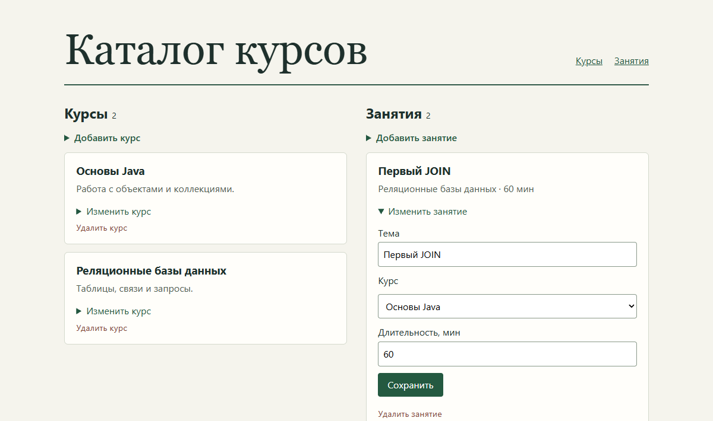

# ПР2. Spring

Каталог из ПР1 перенесён на Spring MVC, Thymeleaf и Hibernate. В браузере
можно создать и изменить курс, добавить или перенести занятие и удалить
обе записи. При удалении курса с занятиями сервер отвечает 409.



Контроллер передаёт действия формы в `EventService`. `CatalogService`
открывает транзакцию для каждого изменения и обращается к репозиторию.
Hibernate проверяет схему, которую создаёт `sql/catalog.sql`.

## Запуск

Создайте пустую БД `catalog_spring` и выполните из корня проекта под JDK 25:

```powershell
psql -W -h 127.0.0.1 -p 15432 -U catalog -d catalog_spring -v ON_ERROR_STOP=1 -f lab-02/sql/catalog.sql
.\lab-02\gradlew.bat -p lab-02 clean build
$env:CATALOG_DB_PASSWORD = Read-Host 'Пароль PostgreSQL' -MaskInput
java -jar lab-02/build/libs/catalog-spring.jar
```

URL и пользователя можно задать через `CATALOG_DB_URL` и `CATALOG_DB_USER`.
На Windows при ошибке `GradleWorkerMain` используйте ASCII-пути к проекту и
`GRADLE_USER_HOME`. [Открыть каталог](http://127.0.0.1:8081/catalog/).

## Проверка

20 тестов на Kotlin, включая браузерный CRUD в Edge. Команда для запущенного приложения:

```powershell
.\lab-02\gradlew.bat -p lab-02 test "-PcatalogUrl=http://127.0.0.1:8081/catalog/"
```

Отчёт JaCoCo находится в `build/reports/jacoco/test/html/index.html`.
