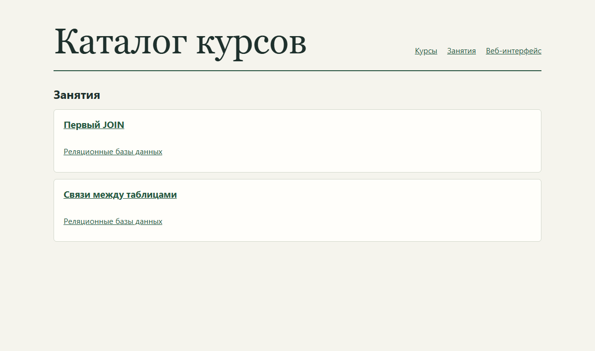

# ПР3. REST

В ПР1 API можно было бы добавить через JAX-RS на GlassFish. Здесь выбран
Spring REST, потому что он переиспользует сервисы, Hibernate и валидацию ПР2.
Gradle подключает `lab-02` как составную сборку.



| Метод | Ресурс от `/catalog/api` | Результат |
|---|---|---|
| GET | `/courses`, `/lessons` | Списки. Для занятий есть фильтр `courseId` |
| GET | `/courses/{id}`, `/lessons/{id}` | Одна запись |
| POST | `/courses`, `/lessons` | 201 и `Location` |
| PUT, DELETE | `/courses/{id}`, `/lessons/{id}` | 204 |

Курс принимает `title` и `description`, занятие принимает `courseId`,
`topic` и `minutes`. Указывайте `Content-Type` для тела и `Accept` для
ответа. API поддерживает JSON и XML. В XML есть ссылка на `catalog.xsl`.
`?format=html` применяет тот же XSL на сервере для браузеров без XSLT.

## Запуск и проверка

Создайте пустую БД `catalog_rest`. Команды выполняются из корня под JDK 25.

```powershell
psql -W -h 127.0.0.1 -p 15432 -U catalog -d catalog_rest -v ON_ERROR_STOP=1 -f lab-02/sql/catalog.sql
.\lab-03\gradlew.bat -p lab-03 clean build
$env:CATALOG_DB_PASSWORD = Read-Host 'Пароль PostgreSQL' -MaskInput
java -jar lab-03/build/libs/catalog-rest.jar
```

```powershell
curl.exe -H 'Accept:application/xml' http://127.0.0.1:8082/catalog/api/courses
.\lab-03\gradlew.bat -p lab-03 test "-PcatalogUrl=http://127.0.0.1:8082/catalog/"
```

Тест проверяет CRUD в обоих форматах и ответы 400, 404 и 409.
[Список курсов в HTML](http://127.0.0.1:8082/catalog/api/courses?format=html).
