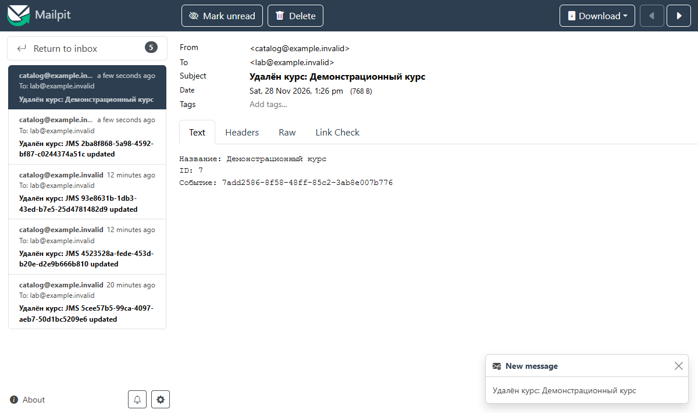

# ПР4. JMS

Формы и REST из ПР3 используют один сервис. Он сохраняет изменение каталога
и событие outbox в одной транзакции PostgreSQL. Планировщик отправляет
JSON в Artemis как `TextMessage` и удаляет запись outbox после двух отправок.



| Очередь | Результат |
|---|---|
| `catalog.audit` | Тип операции, сущность, ID и поля сохраняются в `catalog_audit` |
| `catalog.notify` | При удалении курса отправляется письмо |

Оба обработчика проверяют сообщение. Уникальный ID события защищает аудит
от повторов. Для SMTP остаётся окно повтора при сбое между доставкой и
фиксацией отправки. Логи идут в консоль через SLF4J SimpleLogger.

## Запуск

Создайте пустую БД `catalog_jms`. Для встроенного брокера нужны JDK 25,
Artemis 2.44.0 и Netty 4.1. Команды для PowerShell из корня проекта.

```powershell
psql -W -h 127.0.0.1 -p 15432 -U catalog -d catalog_jms -v ON_ERROR_STOP=1 -f lab-02/sql/catalog.sql
psql -W -h 127.0.0.1 -p 15432 -U catalog -d catalog_jms -v ON_ERROR_STOP=1 -f lab-04/sql/messaging.sql
docker run -d --name aks-lab04-mailpit -p 127.0.0.1:18025:8025 -p 127.0.0.1:11025:1025 axllent/mailpit:v1.28.4
.\lab-04\gradlew.bat -p lab-04 clean build
$env:CATALOG_DB_PASSWORD = Read-Host 'Пароль PostgreSQL' -MaskInput
java '-Djava.net.preferIPv4Stack=true' -jar lab-04/build/libs/catalog-jms.jar
```

[Каталог](http://127.0.0.1:8083/catalog/) · [Mailpit](http://127.0.0.1:18025/).
Получатели задаются через `CATALOG_MAIL_RECIPIENTS`, SMTP через
`CATALOG_SMTP_HOST` и `CATALOG_SMTP_PORT`. По умолчанию используется
локальный тестовый почтовый ящик.

## Проверка

Сквозной тест сверяет шесть изменений с журналом и находит одно письмо.

```powershell
.\lab-04\gradlew.bat -p lab-04 test "-PcatalogUrl=http://127.0.0.1:8083/catalog/" "-PmailpitUrl=http://127.0.0.1:18025/"
```
